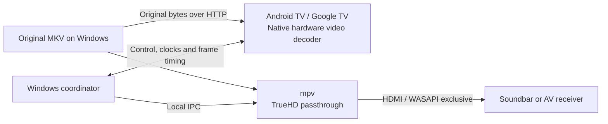

# DualTheater

**Experimental beta — still in testing.** This is a working prototype for experimentation, not a finished or broadly validated home-theater player. Physical lip-sync, device compatibility and long-session reliability still need testing.

DualTheater plays the **video on an Android TV or Google TV** using its native hardware decoder, while a **Windows PC sends the original Dolby TrueHD Atmos audio over HDMI** to a soundbar or AV receiver. The two devices are coordinated over the home network.

## Why this project exists

DualTheater aims to make high-quality 4K remux playback with lossless audio possible using a Windows laptop or desktop PC you already own, together with your compatible TV and HDMI sound system. By putting that existing hardware to work, it can help avoid the cost of a separate dedicated media player, such as an NVIDIA Shield. It is an experimental approach, and compatibility and synchronization still need testing on each setup.

A TV's internal player may handle HDR video well while being unable to pass through a local file's lossless TrueHD Atmos track. A Windows PC may bitstream that audio correctly while local Dolby Vision video output is difficult or unsupported for the source. DualTheater separates those jobs so an existing TV, PC and compatible HDMI audio device can each do the part they support.

The goal is **native TV HDR video + untouched TrueHD Atmos packets + stable A/V synchronization**, without transcoding or requiring another playback box. It does not add codecs or HDR profiles that the TV lacks, and it cannot make an incompatible HDMI receiver accept TrueHD.



## Compatibility

This project is **brand-independent** and designed for Android TV and Google TV devices running Android 8 or later. It is not proven to work on every device.

- The TV must support the particular codec, resolution, HDR format and profile through Android's hardware decoding APIs.
- HDR10, HDR10+ and Dolby Vision depend on the media, container metadata, TV hardware and firmware. Dolby Vision Profile 7/FEL reconstruction is not promised. Profile 5 must not be treated as having an HDR10-compatible base layer.
- The Windows PC must already be able to bitstream the source's TrueHD track to the chosen HDMI endpoint using mpv/WASAPI exclusive mode.
- The soundbar or receiver needs a compatible HDMI input. The design does not rely on the TV forwarding TrueHD audio.
- The network must have headroom above the remux's peak bitrate. A nominal 100 Mbps TV Ethernet port may be a bottleneck.

There is no platform-specific TV brand integration, video re-encode, HDR conversion, audio resampling or adaptive transcoding fallback.

## Current features

- Original-file HTTP range streaming; the TV receives the original container and uses only a video renderer.
- Hardware-only Media3 decoding to a SurfaceView, with aspect ratio preservation and a heap-aware sample-buffer budget.
- TrueHD passthrough using the user's existing mpv installation and an explicit WASAPI HDMI endpoint. Normal mode rejects PCM fallback.
- Laptop discovery, one-time six-digit pairing and remembered reconnection.
- TV remote controls: left/right seek, hold to preview larger jumps, middle/OK play-pause, and a bottom elapsed/total timeline with buffered progress.
- Coordinated pause, seek and scheduled resume; saved latency calibration; video-side drift correction and error/buffering watchdogs.

## Quick start

1. Install Python 3.10+ and a suitable Windows [mpv build](https://mpv.io/installation/). Confirm standalone TrueHD passthrough works with your HDMI device first.
2. Sideload the beta APK from the project's Releases page onto the TV. Use the matching Windows host bundle from the same release.
3. Connect the PC's HDMI output directly to the soundbar/receiver's HDMI input and select that input. Use the TV's internal DualTheater app for video.
4. Run `Start.cmd` on Windows. If mpv is not on PATH, the launcher asks for its executable path. Select the exact `wasapi/...` HDMI device from the displayed list.
5. Select the laptop's name in the TV app. Enter the six-digit code shown on Windows once. Remembered laptops reconnect automatically.
6. Open **http://localhost:8764**, choose a local MKV and press **Load**, then **Play / resume**. Auto-selection chooses a TrueHD audio track; track IDs can also be selected explicitly.
7. Independently confirm the TV's active HDR mode and the receiver's audio-format indication. API reports alone do not prove correct physical output.
8. Calibrate **Video lead** using a clear sound/picture event. Positive values advance the picture relative to sound. Use **Resynchronize** after large changes.

Debug APKs are development-signed. If an existing installation has a different signing certificate, uninstall it before installing this APK; remembered TV pairing settings will then need to be recreated. CI debug signing keys are not retained or published.

```powershell
.\Start.ps1 -ListDevices
.\Start.ps1 -MpvPath 'C:\path\to\mpv.exe' -Device 'wasapi/your-hdmi-device-id'
```

Allow Python on the private home network if prompted. Discovery uses UDP 8767, control TCP 8766, and media TCP 8765. The browser controller binds to localhost on TCP 8764. If discovery is blocked, use the remembered-laptop shortcut or **Advanced connection**.

## TV remote

| Button | Action |
| --- | --- |
| Middle / OK | Toggle coordinated play/pause |
| Left / right | Preview backward/forward by 10 seconds |
| Hold a direction | Accumulate a larger seek; commit after release |
| Up / down | Show the timeline |
| Back during preview | Cancel the preview |
| Dedicated transport buttons | Equivalent play, pause, rewind and fast-forward controls |

The timeline auto-hides after five seconds while playing. It stays visible while paused, buffering or synchronizing. Seeking while paused remains paused. Pressing OK during a preview commits that position and toggles the final play state. Input is held while a synchronization operation is pending.

All committed transport operations go through the Windows coordinator. The TV does not independently seek or resume its video clock in response to remote buttons.

## Synchronization and beta limits

The audio clock is the master. The host compares mpv's driver-adjusted audio position with scheduled TV frame timestamps using synchronized monotonic clocks. Small corrections change **video speed only**. Sustained drift or a buffer underrun triggers a shared pause/prepare/restart barrier.

These are estimated API timings, not measurements of sound pressure or photons. Panel processing, receiver buffering, refresh cadence, Windows scheduling and firmware behavior can introduce fixed latency or variable error. A small drift value does not prove acoustic lip-sync. Calibration and longer real-device tests are required, particularly after seeking and pause/resume.

Basic simultaneous TV video and receiver-reported Atmos playback have been observed on one setup. Broader TV coverage, discovery, remote-control behavior, long-term stability and physical A/V sync remain under testing. See [testing status](docs/testing.md) and the [hardware test guide](docs/hardware-test.md).

The current target is an ordinary single-timeline MKV. Subtitles, playlists, video-track switching, app background playback, automatic playback resume after reconnect, unusual timestamp origins and exotic containers are not validated. After reconnecting, reload the media on Windows. TrueHD may briefly relock after pause or seek.

## Build and test

The Python host uses the standard library. The Android project pins Media3 1.9.0, Android Gradle Plugin 8.13.2 and Gradle 8.13. Install JDK 17 or 21, Android SDK Platform 36 and Build Tools 36.1.0, then run:

```powershell
.\Build-TV.ps1
python -m unittest discover -s tests -v
.\android\gradlew.bat --project-dir android testDebugUnitTest lintDebug
```

Set `DUALTHEATER_MPV` to the full mpv executable path to include the optional Windows IPC/TrueHD tests. Those tests use **null output**, so they do not open HDMI. Tests without that variable skip those checks.

The generated `calibration-SDR-TrueHD-no-Atmos.mkv` contains an original flash/beep pattern with **SDR H.264 video and stereo TrueHD, without Atmos**. It is for basic timing checks, not HDR/Atmos validation. Its generator is included; no film footage is distributed.

## Privacy and network scope

Pairing and playback use cleartext on a trusted home LAN. Do not expose these ports to the Internet. Keep `pairings.json`, local settings, calibration, logs, private device identifiers and signing keys out of Git. Preserve `pairings.json` locally when updating to retain remembered TVs. Discovery does not advertise pairing codes or credentials.

Public reports should contain redacted, minimal evidence rather than raw logs or media files. See [SECURITY.md](SECURITY.md), [architecture](docs/architecture.md), [connection setup](docs/easy-connection.md) and [third-party notices](THIRD_PARTY_NOTICES.md).
