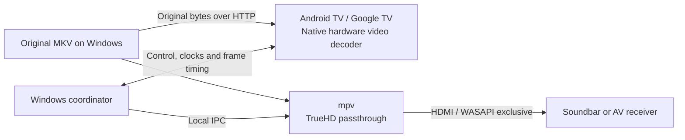

# DualTheater

**Experimental beta — still in testing.** This is a working prototype for experimentation, not a finished or broadly validated home-theater player. Physical lip-sync, device compatibility and long-session reliability still need testing.

DualTheater plays the **video on an Android TV or Google TV** using its native hardware decoder, while a **Windows laptop or desktop PC sends the original Dolby TrueHD Atmos audio over HDMI** to a soundbar or AV receiver. The two devices are coordinated over the home network.

## Download

**Current downloadable version: v0.3.0-beta.1 — experimental prerelease, still in testing.** Download both the TV app and Windows host from this same release.

| Download | What to do with it |
| --- | --- |
| [Android TV / Google TV APK](https://github.com/shadow-pheonix/dualtheater/releases/download/v0.3.0-beta.1/DualTheater-TV-v0.3.0-beta.1-debug.apk) | Sideload this installable app onto the TV. |
| [Windows host + source ZIP](https://github.com/shadow-pheonix/dualtheater/releases/download/v0.3.0-beta.1/DualTheater-v0.3.0-beta.1.zip) | Extract it on your Windows laptop or desktop PC, install Python and mpv separately, then run `Start.cmd`. This is not a standalone Windows EXE or installer. |
| [SHA-256 checksums](https://github.com/shadow-pheonix/dualtheater/releases/download/v0.3.0-beta.1/SHA256SUMS.txt) | Compare with `Get-FileHash` if you want to verify the downloads. |

[Release notes and all assets](https://github.com/shadow-pheonix/dualtheater/releases/tag/v0.3.0-beta.1) · [All releases](https://github.com/shadow-pheonix/dualtheater/releases) · [Installation and operating instructions](#how-to-use)

No Android Studio, Java, Gradle or FFmpeg installation is needed to use the downloaded APK and host. Those development tools are only relevant to building or generating test media. Documentation on `main` may be newer than the release ZIP; the commands below target the linked beta.

## Why this project exists

DualTheater aims to make high-quality 4K remux playback with lossless audio possible using a Windows laptop or desktop PC you already own, together with your compatible TV and HDMI sound system. By putting that existing hardware to work, it can help avoid the cost of a separate dedicated media player, such as an NVIDIA Shield. It is an experimental approach, and compatibility and synchronization still need testing on each setup.

A TV's internal player may handle HDR video well while being unable to pass through a local file's lossless TrueHD Atmos track. A Windows laptop or desktop PC may bitstream that audio correctly while local Dolby Vision video output is difficult or unsupported for the source. DualTheater separates those jobs so an existing TV, Windows laptop or desktop PC, and compatible HDMI audio device can each do the part they support.

The goal is **native TV HDR video + untouched TrueHD Atmos packets + stable A/V synchronization**, without transcoding or requiring another playback box. It does not add codecs or HDR profiles that the TV lacks, and it cannot make an incompatible HDMI receiver accept TrueHD.



## Compatibility

This project is **brand-independent** and designed for Android TV and Google TV devices running Android 8 or later. It is not proven to work on every device.

- The TV must support the particular codec, resolution, HDR format and profile through Android's hardware decoding APIs.
- HDR10, HDR10+ and Dolby Vision depend on the media, container metadata, TV hardware and firmware. Dolby Vision Profile 7/FEL reconstruction is not promised. Profile 5 must not be treated as having an HDR10-compatible base layer.
- The Windows laptop or desktop PC needs an **HDMI output**, or a **USB-C (Type-C) port that supports display/audio output through a compatible USB-C-to-HDMI adapter** (for example, [DisplayPort Alt Mode](https://www.displayport.org/displayport-over-usb-c/)). A USB-C connector alone does not guarantee this capability; a charging/data-only port is insufficient. The adapter and driver must also support the required TrueHD passthrough; adapter-based operation has not yet been verified for this project.
- The Windows laptop or desktop PC must already be able to bitstream the source's TrueHD track to the chosen HDMI endpoint using mpv/WASAPI exclusive mode.
- The soundbar or receiver needs a compatible HDMI input. The design does not rely on the TV forwarding TrueHD audio.
- The network must have headroom above the remux's peak bitrate. A nominal 100 Mbps TV Ethernet port may be a bottleneck.

There is no platform-specific TV brand integration, video re-encode, HDR conversion, audio resampling or adaptive transcoding fallback.

## Current features

- Original-file HTTP range streaming; the TV receives the original container and uses only a video renderer.
- Hardware-only Media3 decoding to a SurfaceView, with aspect ratio preservation and a heap-aware sample-buffer budget.
- TrueHD passthrough using the user's existing mpv installation and an explicit WASAPI HDMI endpoint. Normal mode rejects PCM fallback.
- Laptop discovery, one-time six-digit pairing and remembered reconnection.
- TV remote controls: left/right seek, hold to preview larger jumps, middle/OK play-pause, and a bottom elapsed/total timeline with buffered progress.
- Coordinated pause, seek and scheduled resume; saved latency calibration; video-side drift correction and error/buffering watchdogs.

## How to use

### 1. Prepare the Windows laptop or desktop PC

Install [Python for Windows](https://www.python.org/downloads/windows/) 3.10 or later and a suitable [Windows mpv build](https://mpv.io/installation/). The host uses only Python's standard library; there is no `pip install` step. The beta was tested with Python 3.11. Extract the mpv distribution and keep its supporting files together. The examples use `C:\Tools\mpv\mpv.exe`; replace that with your own path.

Connect the computer's HDMI output, or a compatible HDMI adapter on a display-capable USB-C port, to the soundbar/receiver's **HDMI IN** and select that input. The TV will run its own DualTheater app for video. Put the TV and computer on the same trusted home network. Keep the computer awake during playback.

Download the files using the links above, or run this in PowerShell:

```powershell
$downloadDir = Join-Path $env:USERPROFILE 'Downloads\DualTheater'
New-Item -ItemType Directory -Path $downloadDir -Force | Out-Null
Set-Location -LiteralPath $downloadDir
$releaseUrl = 'https://github.com/shadow-pheonix/dualtheater/releases/download/v0.3.0-beta.1'
$files = @('DualTheater-v0.3.0-beta.1.zip', 'DualTheater-TV-v0.3.0-beta.1-debug.apk', 'SHA256SUMS.txt')
foreach ($file in $files) {
    Invoke-WebRequest -Uri "$releaseUrl/$file" -OutFile $file
}
Get-FileHash .\DualTheater-v0.3.0-beta.1.zip, .\DualTheater-TV-v0.3.0-beta.1-debug.apk -Algorithm SHA256
Get-Content .\SHA256SUMS.txt
```

Compare each file's hash with its matching line in `SHA256SUMS.txt`. Then extract into a fresh folder and enter the directory containing `Start.cmd`:

```powershell
Expand-Archive -LiteralPath .\DualTheater-v0.3.0-beta.1.zip -DestinationPath .\extracted
Set-Location .\extracted\dualtheater
```

If you downloaded/extracted manually, open PowerShell in the extracted `dualtheater` folder instead. All host commands below run from that folder. Check that Python is available with `python --version` or `py -3 --version`.

### 2. Install the TV app

Transfer the APK to the TV and open it with a file manager/package installer, allowing that installer to install apps when the TV asks. Open **DualTheater TV Beta** after installation. TV menu names and available transfer methods vary by device.

Alternatively, use [Android SDK Platform-Tools](https://developer.android.com/tools/releases/platform-tools) and [ADB](https://developer.android.com/tools/adb) from Windows. The commands below assume `adb` is on PATH. If your TV offers wireless debugging with pairing, enable it in Developer options and use its **pairing address** first:

```powershell
$pairingAddress = Read-Host 'Pairing address shown by the TV (IP:port)'
adb pair $pairingAddress
```

Enter the pairing code when ADB asks. Then use the TV's **debugging connection address**, which may have a different port. If your TV uses an already-authorized network ADB connection, start here instead:

```powershell
$tvAddress = Read-Host 'TV debugging connection address (IP:port)'
adb connect $tvAddress
adb devices
$apkPath = Read-Host 'Full path to the downloaded APK, without surrounding quotes'
adb -s $tvAddress install -r $apkPath
```

Accept the debugging prompt on the TV if one appears, and rerun the connection/install command after authorization. Wireless ADB availability depends on the TV and Android version; use a supported sideloading method if it is unavailable. **ADB is only needed for installation/debugging, not normal playback or app pairing.**

Debug APKs are development-signed. If installation reports a different signing certificate, uninstall the previous TV app before installing this APK; that removes its remembered pairing settings. CI debug signing keys are not retained or published.

### 3. Select HDMI audio and start the Windows host

The simplest launch is to double-click `Start.cmd`, or run:

```powershell
.\Start.cmd
```

If mpv is not on PATH or in `tools\mpv.exe`, the launcher asks for its executable path. It lists audio devices and asks for the exact `wasapi/...` name of your HDMI soundbar/receiver. Copy the device name without surrounding quotes; do not select laptop speakers or a Bluetooth endpoint.

To list devices separately and supply the choice explicitly:

```powershell
.\Start.cmd -MpvPath "C:\Tools\mpv\mpv.exe" -ListDevices
.\Start.cmd -MpvPath "C:\Tools\mpv\mpv.exe" -Device "wasapi/REPLACE_WITH_EXACT_HDMI_DEVICE_ID"
```

Replace the example path and device ID with your own values. If Python cannot be found, add `-PythonPath "C:\path\to\python.exe"` to the launch command. `Start.cmd` runs the bundled PowerShell launcher without requiring a permanent execution-policy change.

For users who prefer launching Python directly, these are equivalent device-listing and host-start commands; run only one host instance:

```powershell
python -m host.server --mpv "C:\Tools\mpv\mpv.exe" --list-devices
python -m host.server --mpv "C:\Tools\mpv\mpv.exe" --device "wasapi/REPLACE_WITH_EXACT_HDMI_DEVICE_ID"
```

You can substitute `py -3` for `python` if that is your Python launcher. To confirm standalone HDMI passthrough before using DualTheater, stop the host and run this audio-only test with a known TrueHD Atmos source:

```powershell
& "C:\Tools\mpv\mpv.exe" --vid=no --ao=wasapi --audio-exclusive=yes --audio-spdif=truehd --audio-device="wasapi/REPLACE_WITH_EXACT_HDMI_DEVICE_ID" "D:\Movies\movie.mkv"
```

Close that test player before starting DualTheater. Independently confirm normal audio and the soundbar/receiver's format indication. The TV app cannot fix a standalone HDMI passthrough failure.

### 4. Pair the TV and load a movie

1. Leave the Windows host running. Open **http://localhost:8764** on that same Windows laptop or desktop PC.
2. Open the TV app and select your computer's name. Enter the six-digit code shown in the Windows terminal or browser controller. This app pairing is separate from ADB pairing; remembered app credentials are reused on later connections.
3. In the Windows browser controller's **Prepare the original media** section, paste the full local movie path, for example `D:\Movies\movie.mkv`, **without surrounding quotes**. This is a text field, not a file-upload button; the file stays on the computer.
4. Leave **Initial audio track** at `auto` to select TrueHD, or enter an mpv audio-track ID when needed. Press **Load** and wait for preparation, then **Play / resume**.
5. Confirm the TV's active HDR mode and the soundbar/receiver's Atmos indication independently. Software status alone does not prove correct physical output.

Allow Python on the private home network if prompted. Discovery uses UDP 8767, control TCP 8766 and media TCP 8765. The browser controller binds to localhost on TCP 8764; it is not a browser remote for the phone or TV. Guest-network isolation, VPN routing or firewall rules may block discovery. Use the remembered-computer shortcut or **Advanced connection** if needed; see [connection setup](docs/easy-connection.md).

## Operating the player

| Task | How to do it |
| --- | --- |
| Play or pause | Press the TV remote's middle/OK button, or **Play / resume** / **Pause** in the Windows browser. |
| Seek with the TV remote | Press left/right for a 10-second preview; hold for a larger jump and release to commit. A seek while paused stays paused. |
| Seek to an exact time | Enter seconds in **Seek to seconds** in the Windows browser, then press **Seek**. For example, `600` seeks to 10:00. |
| Change audio language/track | Select a track under **Audio track** and press **Switch track**. Normal mode requires TrueHD output; other codecs are not a supported fallback in this beta. |
| Load another movie | Replace the full media path in the browser, press **Load**, wait for preparation, then **Play / resume**. |
| Recover after a disturbance | If picture/audio are out of step, try **Resynchronize**. If the connection was lost, reconnect the TV, reload the media and then resume. |
| Stop the session | Pause playback, then press **Ctrl+C** in the Windows host terminal. Closing just the browser page does not stop the host. |

The original MKV remains on Windows throughout playback. Keep the host running and the selected HDMI audio device connected. Brief receiver relock can occur after a pause or seek.

### Adjust physical lip-sync

Use **Calibrate physical latency** in the Windows browser controller while watching a clear sound/picture event. Increase **Video lead** if sound arrives before the picture; decrease it if sound arrives late. Use the 10 ms buttons or enter a value, press **Save**, then **Resynchronize** to apply a large adjustment immediately. The offset is saved across launches. These controls do not re-encode or change the speed of the TrueHD audio.

You can load the included `calibration-SDR-TrueHD-no-Atmos.mkv` using its full extracted path for a flash/beep test. It is **SDR with stereo TrueHD, not an HDR/Atmos sample**; confirm the result again with the actual movie and processing modes. Automatic camera/microphone calibration and a dedicated TV calibration screen are not implemented in this beta. Physical sync after start, seek and pause/resume still needs hardware validation.

### Common setup problems

- **No Windows EXE:** use the ZIP with Python and mpv, then `Start.cmd`; there is no standalone Windows installer yet.
- **No computers appear on the TV:** check that the host is running, both devices share a trusted LAN, and discovery is not blocked. Try the remembered connection or advanced fields.
- **No sound, noise or rejected audio:** verify the selected HDMI endpoint/input and cable, close competing exclusive-audio apps and test standalone mpv. Choose an actual TrueHD track; do not use PCM diagnostic mode as evidence of Atmos.
- **Buffering or repeated resynchronization:** check network throughput and the host's error/status messages. A 100 Mbps TV Ethernet port may be slower than remux peaks. See the [hardware test guide](docs/hardware-test.md).
- **Installing a later beta:** use a matching host/APK pair, preserve the Windows `pairings.json` and `calibration.json` locally, and follow that release's instructions. A TV signing-certificate change may require uninstall/re-pairing.

## TV remote

| Button | Action |
| --- | --- |
| Middle / OK | Toggle coordinated play/pause |
| Left / right | Preview backward/forward by 10 seconds |
| Hold a direction | Accumulate a larger seek; commit after release |
| Up / down | Show the timeline |
| Back during preview | Cancel the preview |
| Dedicated transport buttons | Equivalent play, pause, rewind and fast-forward controls |

The timeline auto-hides after five seconds while playing. It stays visible while paused, buffering or synchronizing. Seeking while paused remains paused. Pressing OK during a preview commits that position and toggles the final play state. Input is held while a synchronization operation is pending.

All committed transport operations go through the Windows coordinator. The TV does not independently seek or resume its video clock in response to remote buttons.

## Synchronization and beta limits

The audio clock is the master. The host compares mpv's driver-adjusted audio position with scheduled TV frame timestamps using synchronized monotonic clocks. Small corrections change **video speed only**. Sustained drift or a buffer underrun triggers a shared pause/prepare/restart barrier.

These are estimated API timings, not measurements of sound pressure or photons. Panel processing, receiver buffering, refresh cadence, Windows scheduling and firmware behavior can introduce fixed latency or variable error. A small drift value does not prove acoustic lip-sync. Calibration and longer real-device tests are required, particularly after seeking and pause/resume.

Basic simultaneous TV video and receiver-reported Atmos playback have been observed on one setup. Broader TV coverage, discovery, remote-control behavior, long-term stability and physical A/V sync remain under testing. See [testing status](docs/testing.md) and the [hardware test guide](docs/hardware-test.md).

The current target is an ordinary single-timeline MKV. Subtitles, playlists, video-track switching, app background playback, automatic playback resume after reconnect, unusual timestamp origins and exotic containers are not validated. After reconnecting, reload the media on Windows. TrueHD may briefly relock after pause or seek.

## Build and test

For ongoing development or a new Codex session, start with [project context](docs/context.md) and follow [AGENTS.md](AGENTS.md). Updating the shared context after meaningful changes and before handoffs is mandatory. Whenever a project change makes installation or operating instructions outdated, update the affected README instructions in that same change before publishing.

The Python host uses the standard library. The Android project pins Media3 1.9.0, Android Gradle Plugin 8.13.2 and Gradle 8.13. Install JDK 17 or 21, Android SDK Platform 36 and Build Tools 36.1.0, then run:

```powershell
.\Build-TV.ps1
python -m unittest discover -s tests -v
.\android\gradlew.bat --project-dir android testDebugUnitTest lintDebug
```

Set `DUALTHEATER_MPV` to the full mpv executable path to include the optional Windows IPC/TrueHD tests. Those tests use **null output**, so they do not open HDMI. Tests without that variable skip those checks.

The generated `calibration-SDR-TrueHD-no-Atmos.mkv` contains an original flash/beep pattern with **SDR H.264 video and stereo TrueHD, without Atmos**. It is for basic timing checks, not HDR/Atmos validation. Its generator is included; no film footage is distributed.

## Privacy and network scope

Pairing and playback use cleartext on a trusted home LAN. Do not expose these ports to the Internet. Keep `pairings.json`, local settings, calibration, logs, private device identifiers and signing keys out of Git. Preserve `pairings.json` locally when updating to retain remembered TVs. Discovery does not advertise pairing codes or credentials.

Public reports should contain redacted, minimal evidence rather than raw logs or media files. See [SECURITY.md](SECURITY.md), [architecture](docs/architecture.md), [connection setup](docs/easy-connection.md) and [third-party notices](THIRD_PARTY_NOTICES.md).
