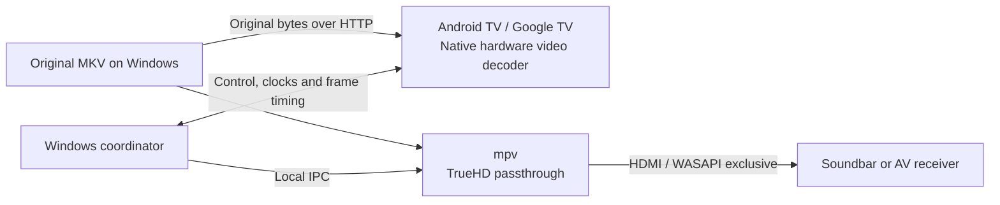

# DualTheater

**Experimental beta — still in testing.** This is a working prototype for experimentation, not a finished or broadly validated home-theater player. Physical lip-sync, device compatibility and long-session reliability still need testing.

DualTheater plays the **video on an Android TV or Google TV** using its native hardware decoder, while a **Windows laptop or desktop PC sends the original Dolby TrueHD Atmos audio over HDMI** to a soundbar or AV receiver. The two devices are coordinated over the home network.

**Unreleased development branch:** `feature/playback-reliability` builds Windows/TV version `0.5.0-beta.2` with diagnostics, sanitized report export, restart protection and the first **DualTheater Calibration Preview** phone client (`0.1.0-beta.1`). The phone uses flash/beep capture timestamps without requiring a separate physical reference fixture. These features are not in the downloadable `0.4.1-beta.1` builds below. The base build and published assets are preserved. See [phone calibration setup](docs/phone-calibration.md) and [diagnostics instructions](docs/diagnostics.md).

## Download

**Current downloadable version: v0.4.1-beta.1 — experimental, still in testing.** The Windows EXE and TV APK are published and verified. Use the matching Windows and TV versions.

| Download | What to do with it |
| --- | --- |
| [Windows x64 portable EXE](https://github.com/shadow-pheonix/dualtheater/releases/download/v0.4.1-beta.1/DualTheater-Windows-v0.4.1-beta.1-x64.exe) | Download and double-click. No installer, administrator privileges, Python installation or terminal is needed. Click **Download mpv** on Connect, or Browse to your own build. |
| [Android TV / Google TV APK](https://github.com/shadow-pheonix/dualtheater/releases/download/v0.4.1-beta.1/DualTheater-TV-v0.4.1-beta.1-debug.apk) | Sideload onto your TV. Includes the matching DualTheater icon and TV launcher banner. |
| [Source ZIP / optional command-line host](https://github.com/shadow-pheonix/dualtheater/releases/download/v0.4.1-beta.1/DualTheater-v0.4.1-beta.1.zip) | For source users/developers; requires Python and mpv. Not needed to use the EXE. |
| [SHA-256 checksums](https://github.com/shadow-pheonix/dualtheater/releases/download/v0.4.1-beta.1/SHA256SUMS.txt) | Compare with `Get-FileHash` to verify downloaded files. |

[Release notes](https://github.com/shadow-pheonix/dualtheater/releases/tag/v0.4.1-beta.1) · [All releases](https://github.com/shadow-pheonix/dualtheater/releases) · [How to use](#how-to-use)

The EXE includes Python and its GUI runtime. Click **Download mpv** inside the app to download it directly from the official upstream release, verify it and select it automatically. This first setup needs Internet access (about 37 MiB); later launches use the cached player offline. **Browse…** still accepts your known-working build. mpv is not embedded or redistributed in our EXE. See [download details and recovery](docs/player-download.md). The EXE is an unsigned development build. Older beta releases and locked local snapshots are preserved.

## Why this project exists

DualTheater aims to make high-quality 4K remux playback with lossless audio possible using a Windows laptop or desktop PC you already own, together with your compatible TV and HDMI sound system. By putting that existing hardware to work, it can help avoid the cost of a separate dedicated media player, such as an NVIDIA Shield. It is an experimental approach, and compatibility and synchronization still need testing on each setup.

A TV's internal player may handle HDR video well while being unable to pass through a local file's lossless TrueHD Atmos track. A Windows laptop or desktop PC may bitstream that audio correctly while local Dolby Vision video output is difficult or unsupported for the source. DualTheater separates those jobs so an existing TV, Windows laptop or desktop PC, and compatible HDMI audio device can each do the part they support.

The goal is **native TV HDR video + untouched TrueHD Atmos packets + stable A/V synchronization**, without transcoding or requiring another playback box. It does not add codecs or HDR profiles that the TV lacks, and it cannot make an incompatible HDMI receiver accept TrueHD.



## Compatibility

This project is **brand-independent** and designed for Android TV and Google TV devices running Android 8 or later. It is not proven to work on every device.

- The TV must support the particular codec, resolution, HDR format and profile through Android's hardware decoding APIs.
- HDR10, HDR10+ and Dolby Vision depend on the media, container metadata, TV hardware and firmware. Dolby Vision Profile 7/FEL reconstruction is not promised. Profile 5 must not be treated as having an HDR10-compatible base layer.
- The Windows laptop or desktop PC needs an **HDMI output**, or a **USB-C (Type-C) port that supports display/audio output through a compatible USB-C-to-HDMI adapter** (for example, [DisplayPort Alt Mode](https://www.displayport.org/displayport-over-usb-c/)). A USB-C connector alone does not guarantee this capability; a charging/data-only port is insufficient. The adapter and driver must also support the required TrueHD passthrough; adapter-based operation has not yet been verified for this project.
- The Windows laptop or desktop PC must already be able to bitstream the source's TrueHD track to the chosen HDMI endpoint using mpv/WASAPI exclusive mode.
- The soundbar or receiver needs a compatible HDMI input. The design does not rely on the TV forwarding TrueHD audio.
- The network must have headroom above the remux's peak bitrate. A nominal 100 Mbps TV Ethernet port may be a bottleneck.

There is no platform-specific TV brand integration, video re-encode, HDR conversion, audio resampling or adaptive transcoding fallback.

## Current features

- Portable native Windows app with saved audio setup, friendly device names, movie picker and transport controls.
- Original-file HTTP range streaming; the TV receives the original container and uses only a video renderer.
- Hardware-only Media3 decoding to a SurfaceView, with aspect ratio preservation and a heap-aware sample-buffer budget.
- TrueHD passthrough using the user's existing mpv installation and an explicit WASAPI HDMI endpoint. Normal mode rejects PCM fallback.
- Laptop discovery, one-time six-digit pairing and remembered reconnection.
- TV remote controls: left/right seek, hold to preview larger jumps, middle/OK play-pause, and a bottom elapsed/total timeline with buffered progress.
- Coordinated pause, seek and scheduled resume; saved latency calibration; video-side drift correction and error/buffering watchdogs.

## How to use

### 1. Download, connect HDMI and install the TV app

Use a Windows 10/11 **x64 laptop or desktop PC**. Connect its HDMI output, or a compatible HDMI adapter on a display-capable USB-C port, to your soundbar/receiver's **HDMI IN**. Select that HDMI input. Put the computer and TV on the same trusted home network and keep the computer awake during playback.

Download the Windows EXE and matching APK from [Download](#download). Transfer the APK to the TV and open it using a file manager/package installer. Allow that installer to install apps when the TV asks. Then open **DualTheater TV Beta**. Device menus vary. For optional ADB commands, see the [advanced installation guide](docs/command-line.md#2-install-the-tv-app).

No Android Studio, Java, Gradle, FFmpeg or Python installation is needed for normal use of the EXE and APK. If you already have a source-host terminal open, stop it before opening the EXE.

### 2. Connect in the Windows app

1. Double-click **DualTheater-Windows-v0.4.1-beta.1-x64.exe**. The application stays in one window with **Connect**, **Player**, and **Settings & help** pages.
2. On **Connect**, click **Download mpv** and wait for verification, extraction and automatic player selection. The app refreshes the audio list when ready. If you prefer your existing build, click **Browse…** and select its `mpv.exe`; keep its DLLs beside it. A saved, downloaded, adjacent or PATH player can already fill in the path. Click **Refresh** if necessary.
3. Under **HDMI audio**, select the soundbar/receiver's friendly Windows name. Speakers and other WASAPI outputs can also appear; selecting one does not guarantee TrueHD capability. There is no long device ID to copy.
4. Click **Start TV connection**. The app displays the computer name and a six-digit code. Allow the app on your private network if Windows asks.
5. On the TV, select that computer and enter the code once. Remembered TVs can reconnect automatically. The Windows app switches to **Player** when the TV connects.

The mpv path and exact audio endpoint are saved privately. On later launches, the app refreshes available devices and starts the connection if the saved setup is still available. If your HDMI output disappears, reconnect it and refresh; the app does not silently substitute another device.

**Go to Player →** is aligned on the right beside the connection buttons. You can also open the **2 Player** tab; connecting the TV switches there automatically.

### 3. Choose a movie and play

On **Player**, click **Choose movie…**, select the original local MKV and click **Load movie**. Wait for both players to prepare, then click **Play**. TrueHD audio is selected automatically. The original file stays on Windows and is streamed directly to the TV; there is no separate upload or conversion step.

Keep the Windows app open throughout playback. Check the TV's active HDR indication and the soundbar/receiver's Atmos indication independently. The app's TrueHD message is software evidence, not proof of correct physical HDR/Atmos output.

## Operating the player

The instructions in this section describe the published `0.4.1-beta.1` build. The development branch adds a **Diagnostics** page and **Export sanitized report…**; see the [feature guide](docs/diagnostics.md). Its separate paired phone client can start a reference test and suggest a saved lip-sync correction; follow [phone calibration instructions](docs/phone-calibration.md). After a TV reconnect or calibration test, reload the movie before playback.

| Task | In the Windows app |
| --- | --- |
| Play or pause | On **Player**, press **Play** or **Pause**. The TV remote's middle/OK button also controls both players. |
| Seek | Drag and release the timeline, use **−10 seconds** / **+10 seconds**, or enter seconds next to **Seek to (seconds)** and press **Seek**. `600` means 10:00. Seeking while paused stays paused. |
| Change audio language/track | Choose under **Audio track**, then press **Switch track**. Normal playback requires a TrueHD track; other audio formats are not a supported fallback. |
| Play another movie | Choose it with **Choose movie…**, click **Load movie**, wait, then **Play**. |
| Adjust physical lip-sync | In **Settings & help**, change **Video lead (ms)** and press **Save and resynchronize**. Increase it if sound arrives early; decrease it if sound arrives late. |
| Recover a timing disturbance | On **Player**, click **Resynchronize**. It preserves the paused/playing state while coordinating both players again. |
| Recover a lost TV connection | Reconnect on the TV, then **Load movie** again. Playback controls stay disabled until reloading succeeds. Resume after preparation. |
| Change mpv or HDMI output | On **Connect**, click **Disconnect** first. Use **Download mpv** or **Browse…**, choose the HDMI output, then **Start TV connection**. Reconnect the TV and reload the movie. |
| Stop playback and exit | Close the Windows app. It stops its host/audio process and closes the TV connection. Closing the optional browser controller does not exit the app. |

All transport controls use the existing shared Windows/TV synchronization barrier. Audio speed stays at 1.0x; small drift corrections affect video only. Receiver relock can briefly interrupt sound after a seek or pause/resume.

### Settings, calibration and updates

Desktop settings, remembered TV credentials, calibration and logs are stored under **`%LOCALAPPDATA%\DualTheater`**, not inside the EXE or its temporary extraction folder. Use **Settings & help → Open local settings folder** to find them. Preserve these files privately when updating; do not publish them. Moving/replacing the EXE does not reset them. Downloaded mpv and its supporting DLLs are stored in the `players` subfolder and reused offline. **Settings & help → mpv download / source** opens the exact upstream release; use **Browse…** if you want another build. There is no silent player update. The older source launcher uses its own source-folder state, so the first switch to the EXE may require pairing and calibrating again; the old files are left intact.

The optional source ZIP includes `calibration-SDR-TrueHD-no-Atmos.mkv`, an original flash/beep clip. Extract the ZIP and choose that file in **Player** for a basic timing check. It is **SDR with stereo TrueHD, not HDR/Atmos**. Verify the offset again with your movie and processing modes. These automatic features are absent from published 0.4.1 builds. The development branch has a separate [phone calibration client](docs/phone-calibration.md); a dedicated TV calibration screen is not included.

The APK is development-signed. If Android reports a signing-certificate mismatch, uninstall the previous TV app before installing the new APK and pair again. CI debug signing keys are not retained or published. Use a matching host/APK release; do not run multiple hosts against the default ports.

### Troubleshooting and optional commands

- **mpv download fails:** check Internet/proxy/firewall access to GitHub, then retry **Download mpv**. A failed/cancelled download does not replace your previous player. Close the app to cancel (an in-progress network read can take up to 20 seconds). For manual downloads, extract the entire upstream ZIP, including the nested ZIP, keep DLLs with `mpv.exe` and use **Browse…**. See [recovery details](docs/player-download.md).
- **No HDMI sound or noise:** confirm the selected output, receiver input and cable. Close any competing exclusive-audio player. Test your mpv/HDMI setup independently; the TV companion cannot fix a standalone passthrough failure. See [command-line audio test](docs/command-line.md#3-select-hdmi-audio-and-start-the-windows-host).
- **TV cannot find the computer:** keep both devices on the same trusted LAN. Check private-network firewall permission, guest-client isolation and VPN routing. Discovery uses UDP 8767, control TCP 8766 and media TCP 8765. See [connection setup](docs/easy-connection.md).
- **Connection cannot start:** another EXE or source-host instance may already be using the ports. Close that instance and try again. A second desktop instance asks you to use the existing window.
- **Repeated buffering or resynchronization:** the network must sustain remux peak bitrate; some TV Ethernet ports are limited to 100 Mbps. Check local session details and the [hardware test guide](docs/hardware-test.md).
- **Advanced controls:** **Settings & help → Advanced browser controller** opens the existing Windows-local controller on **http://localhost:8764**. Normal operation does not require a browser.

To launch the portable EXE from PowerShell rather than double-clicking:

```powershell
.\DualTheater-Windows-v0.4.1-beta.1-x64.exe
```

For Python launch commands, downloading/extracting the source ZIP, optional ADB installation and standalone mpv checks, use the [advanced command-line guide](docs/command-line.md). These steps are optional for EXE users.

## TV remote

| Button | Action |
| --- | --- |
| Middle / OK | Toggle coordinated play/pause |
| Left / right | Preview backward/forward by 10 seconds |
| Hold a direction | Accumulate a larger seek; commit after release |
| Up / down | Show the timeline |
| Back during preview | Cancel the preview |
| Dedicated transport buttons | Equivalent play, pause, rewind and fast-forward controls |

The timeline auto-hides after five seconds while playing. It stays visible while paused, buffering or synchronizing. Seeking while paused remains paused. Pressing OK during a preview commits that position and toggles the final play state. Input is held while a synchronization operation is pending.

All committed transport operations go through the Windows coordinator. The TV does not independently seek or resume its video clock in response to remote buttons.

## Synchronization and beta limits

The audio clock is the master. The host compares mpv's driver-adjusted audio position with scheduled TV frame timestamps using synchronized monotonic clocks. Small corrections change **video speed only**. Sustained drift or a buffer underrun triggers a shared pause/prepare/restart barrier.

These are estimated API timings, not measurements of sound pressure or photons. Panel processing, receiver buffering, refresh cadence, Windows scheduling and firmware behavior can introduce fixed latency or variable error. A small drift value does not prove acoustic lip-sync. Calibration and longer real-device tests are required, particularly after seeking and pause/resume.

Basic simultaneous TV video and receiver-reported Atmos playback have been observed on one setup. Broader TV coverage, discovery, remote-control behavior, long-term stability and physical A/V sync remain under testing. See [testing status](docs/testing.md) and the [hardware test guide](docs/hardware-test.md).

The current target is an ordinary single-timeline MKV. Subtitles, playlists, video-track switching, app background playback, automatic playback resume after reconnect, unusual timestamp origins and exotic containers are not validated. After reconnecting, reload the media on Windows. TrueHD may briefly relock after pause or seek.

## Build and test

For ongoing development or a new Codex session, start with [project context](docs/context.md) and follow [AGENTS.md](AGENTS.md). Updating the shared context after meaningful changes and before handoffs is mandatory. Whenever a project change makes installation or operating instructions outdated, update the affected README instructions in that same change before publishing.

This feature branch builds a separate `0.5.0-beta.2` candidate. Its **DualTheater Preview** desktop uses `%LOCALAPPDATA%\DualTheater-Preview` for settings, pairing, calibration, logs and managed players, leaving the base desktop's profile intact. **DualTheater TV Preview** uses a separate Android package (`dev.dualtheater.tv.preview`) and can be installed alongside the base TV app without replacing its settings. Keep build outputs separate from the base EXE/APK and use a matching branch-built host/TV app together. Only run one host at a time. The candidate has not been published or physically validated.

To build the Windows EXE from source on Windows with Python 3.11 x64:

```powershell
python -m venv .venv
.\.venv\Scripts\python.exe -m pip install -r requirements-build.txt
.\.venv\Scripts\python.exe tools_src/build_windows.py
```

The result is `dist/DualTheater.exe`. Packaging includes Python/Tk, app resources, license notices and the original icon; it excludes user state and mpv. `tools_src/generate_icons.py` regenerates original artwork using the build-only Pillow dependency. Release CI verifies the real upstream download, runs host/TrueHD tests with null audio output, and checks the EXE's GUI/resources/local host start-stop and external player startup without opening HDMI. Physical output remains a hardware test.

The Python host uses the standard library. The Android project pins Media3 1.9.0, Android Gradle Plugin 8.13.2 and Gradle 8.13. Install JDK 17 or 21, Android SDK Platform 36 and Build Tools 36.1.0, then run:

```powershell
.\Build-TV.ps1
python -m unittest discover -s tests -v
.\android\gradlew.bat --project-dir android testDebugUnitTest lintDebug
```

Set `DUALTHEATER_MPV` to the full mpv executable path to include the optional Windows IPC/TrueHD tests. Those tests use **null output**, so they do not open HDMI. Tests without that variable skip those checks.

The generated `calibration-SDR-TrueHD-no-Atmos.mkv` contains an original flash/beep pattern with **SDR H.264 video and stereo TrueHD, without Atmos**. It is for basic timing checks, not HDR/Atmos validation. Its generator is included; no film footage is distributed.

## Privacy and network scope

Pairing and playback use cleartext on a trusted home LAN. Do not expose these ports to the Internet. Keep `pairings.json`, local settings, calibration, logs, private device identifiers and signing keys out of Git. Preserve `pairings.json` locally when updating to retain remembered TVs. Discovery does not advertise pairing codes or credentials.

Public reports should contain redacted, minimal evidence rather than raw logs or media files. See [SECURITY.md](SECURITY.md), [architecture](docs/architecture.md), [connection setup](docs/easy-connection.md) and [third-party notices](THIRD_PARTY_NOTICES.md).
